# LLM vs Mind Model

**萃取壓縮的兩條路**

**LLM 是語言的接口**

**Mind Model 是時空結構的知識骨幹**

**壓縮統計，得到語言的極致**

**壓縮時空結構，得到世界的骨幹**

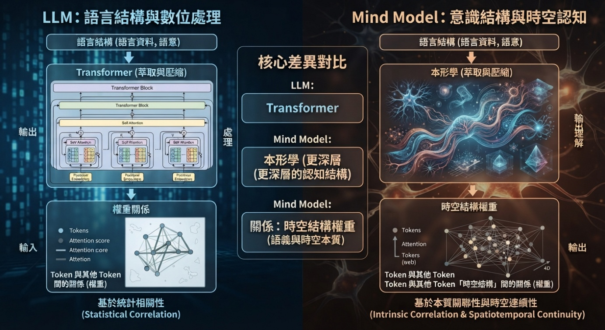

# 摘要 Executive Summary

大型語言模型（LLM）與 Mind Model，是同一條認知壓縮之路的兩種走法。兩者都從「語言結構」出發，都以「萃取與壓縮」為方法，都把知識凝結為「Token 與其他 Token 之間的關係（權重）」。真正的分歧只有一處：壓縮進權重的，是語言的統計規律，還是語言背後的時空結構。

> LLM ＝ 語言結構 → Transformer（萃取與壓縮）→ Token 與其他 Token 間的關係（權重）
>
> Mind Model ＝ 語言結構 → 本形學（萃取與壓縮）→ Token 與其他 Token「時空結構」間的關係（權重）

這一份差異，在語言平面上看不出代價；但一旦走向世界模型與物理 AI——要求狀態、轉移、身分、時序——它就成為決定性的分野。世界模型需要把「世界此刻是什麼、接下來怎麼變」寫成可推理的結構；物理 AI 需要在真實時空中保有身分、組成與時序的判準。純統計的權重描寫世界「像什麼」；時空結構的權重回答世界「是什麼、會怎麼變」。

本白皮書以「三同五異」對照 LLM 與 Mind Model，說明 Mind Model 的必要性，並指出三者的分工定位：LLM 是語言的接口，Mind Model 是時空結構的知識骨幹，世界模型與物理 AI 是理解的落地之處——三者互補，而非取代。

> **關鍵詞：**
>
> LLM　·　Mind Model　·　本形學 Ontypology　·　形 Type　·　萃取與壓縮　·　時空結構　·　世界模型　·　物理 AI

# 目錄

- 第一章　兩條路徑：同一個起點，兩種萃取與壓縮
- 第二章　異同與特色
- 第三章　Mind Model 的必要性
- 第四章　與世界模型、物理 AI 、工業級 AI的關係
- 結語　從關係到結構，從結構到理解

> *本白皮書聚焦 LLM 與 Mind Model 的對照與必要性，*

# 第一章　兩條路徑：同一個起點，兩種萃取與壓縮

## 1.1　共同的起點：語言結構

人類的知識，大部分以語言的形式留存。語法、語義、語用——這套「語言結構」是文明的公共接口，也是任何機器要理解世界時，最先遇到、也最龐大的資料。無論 LLM 或 Mind Model，都選擇從這裡出發：不另造一種知識輸入，而是直接消化人類寫下來的語言。

消化的方法也相同：萃取與壓縮。面對近乎無限的文本，必須萃取出反覆出現的規律，再把規律壓縮進有限的表示之中。這正是「學習」在機器上的樣子——與大腦把經驗壓成概念，是同一種動作。語言結構是原料，萃取與壓縮是方法，兩者皆然。

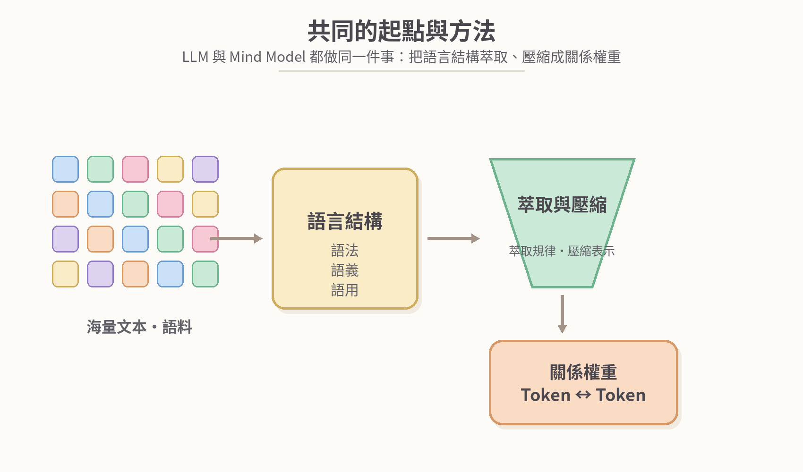

**圖 1-1　共同的起點與方法：從海量語料到關係權重**

## 1.2　兩個公式並讀

把兩條式子並排，起點相同、方法相同、產出的形態也相同——都是「關係的權重」。差別被壓縮在最後一段的定語裡：LLM 的權重，描述 Token 與 Token 之間的關係；Mind Model 的權重，描述 Token 與 Token「時空結構」之間的關係。

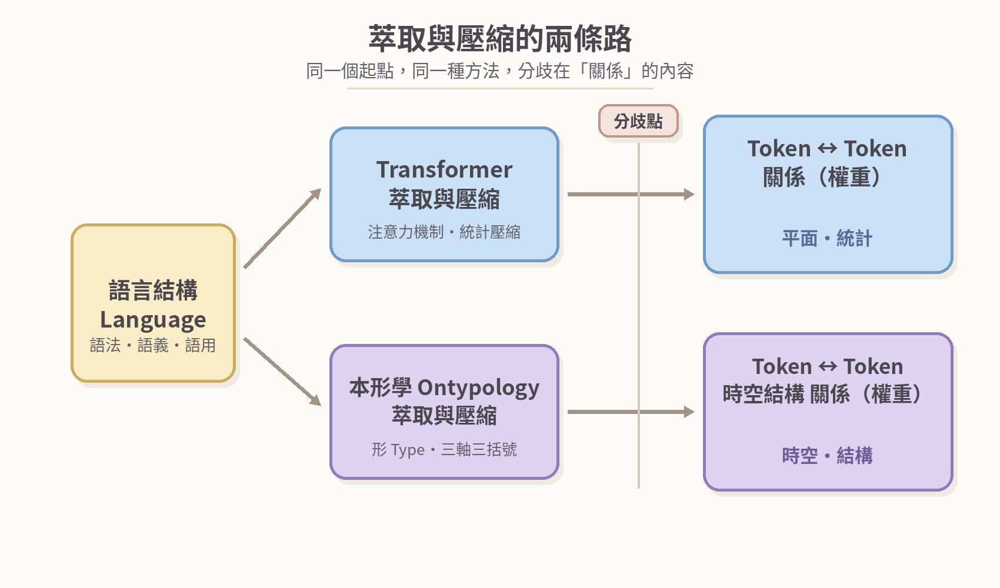

**圖 1-2　萃取與壓縮的兩條路：分歧在「關係」的內容**

## 1.3　分歧點：關係的內容

LLM 學到的關係，是「平面」上的關係：哪個詞常與哪些詞一同出現、在什麼語境下相似、下一個最可能是什麼。這種關係由 Transformer 以注意力機制統計而成，威力驚人——它足以撐起流暢的語言生成與知識召回。

Mind Model 則多走一步：每個 Token 不再只是序列中的一個位置，而要掛上它的「時空結構」——它是什麼樣子、由什麼組成、身分是什麼、隨時間如何運作。Token 與 Token 的關係，因此不只是「像不像」，而是「如何組成、如何歸類、如何依存、如何演化」。

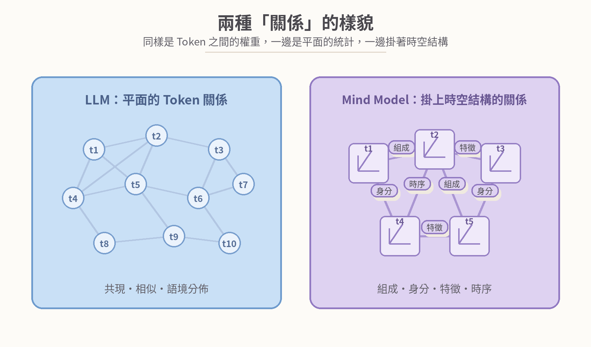

**圖 1-3　兩種「關係」的樣貌：平面的統計，對照掛上時空結構的關係**

> **一句話總結本章：同在壓縮，異在內容。壓縮統計，得到語言的極致；壓縮時空結構，得到世界的骨幹。**

# 第二章　異同與特色

## 2.1　三同：起點・方法・產出

LLM 與 Mind Model 共享三個共識。其一，同一起點：語言結構——兩者都承認語言是知識的第一現場，都以人類文本為師。其二，同一方法：萃取與壓縮——兩者都不靠人工逐條建檔，而是讓規律自己從資料中浮現，再壓進有限的表示。其三，同一產出：關係權重——兩者的成品都是「Token 與其他 Token 之間關係的權重」，知識被寫成關係，而不是清單。

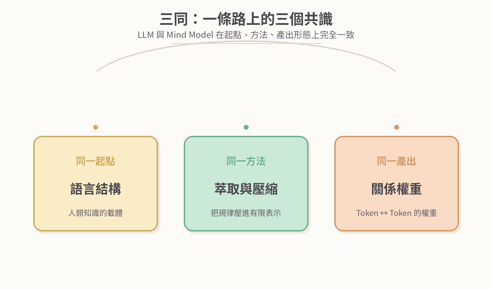

**圖 2-1　三同：一條路上的三個共識**

## 2.2　五異：對照總表

真正分開兩者的，是五個面向：壓縮的內容、關係的型態、知識的樣貌、推理的方式、學習與更新。

| 面向 | LLM | Mind Model |
| --- | --- | --- |
| **壓縮內容** | 語言的統計規律：共現、分佈、語境 | 語言背後的時空結構：形 Type 的組成、身分、特徵、時序 |
| **關係型態** | Token ↔ Token 平面關係 | Token ↔ Token 時空結構關係 |
| **知識樣貌** | 分佈式權重，隱式浮現，難以追溯依據 | 形 Type 的顯式結構，可指認、可命名、可複核 |
| **推理方式** | 機率生成：預測下一個 Token | 結構判斷：形的辨識、歸類與運算 |
| **學習更新** | 訓練與微調：整批更新，代價高昂 | 增補與重構：形可逐次演化，增量進行 |

**表 2-1　LLM 與 Mind Model 五異對照表**

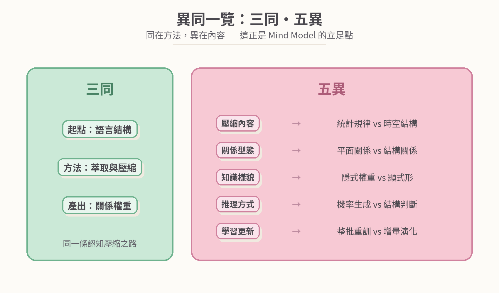

**圖 2-2　異同一覽：三同・五異**

## 2.3　LLM 的特色：語言平面的極致

LLM 把「萃取與壓縮」在語言平面上做到極致：語言理解與生成、上下文泛化、跨語言遷移、知識召回、創意表達、規模效應。它是一台把「表達」做到幾乎完美的機器——也因此，它成為所有人與 AI 對話的第一個窗口。這是 LLM 真正的歷史地位：語言平面的極致，而非智慧的全貌。

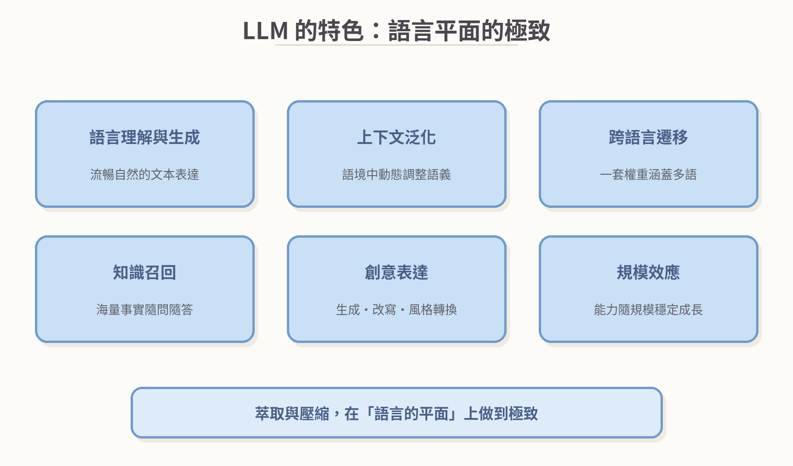

**圖 2-3　LLM 的特色**

## 2.4　Mind Model 的特色：時空平面的骨幹

Mind Model 把「萃取與壓縮」往時空平面再壓一層：結構先於個體、身分恆定不變、組成可拆可判、抽象可歸可類、時序形進形出、可指認可複核。它的成品不是「更會說話的模型」，而是「可以被檢查、被教、被演化」的知識骨幹——知識第一次有了可以逐一驗收的門牌。

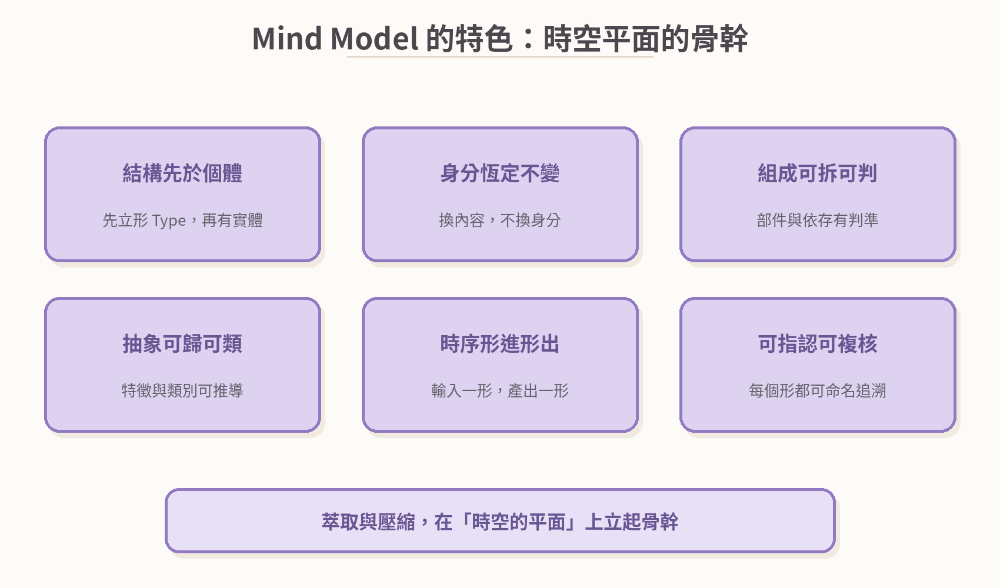

**圖 2-4　Mind Model 的特色**

## 2.5　時空結構的三個關係座標

所謂「時空結構」，在本形學中由空間框架定義，以三軸三括號寫成：

- **[抽象]　相似與特徵關係——**這個形與哪些形相像？它有哪些特徵？這是分類與辨識的座標（X 軸）。
- **{BOM}　組成與結構關係——**它由哪些部件組成？部件如何依存？這是拆解與組裝的座標（Y 軸）。
- **(容器)　身分與空間關係——**它的身分是什麼？位於誰的內部？換掉內容之後，還是它嗎？這是同一性的座標（Z 軸）。

三個座標，把一個 Token 從「序列上的位置」升級為「可以定位、可以拆解、可以歸類、可以追蹤」的形（Type）。

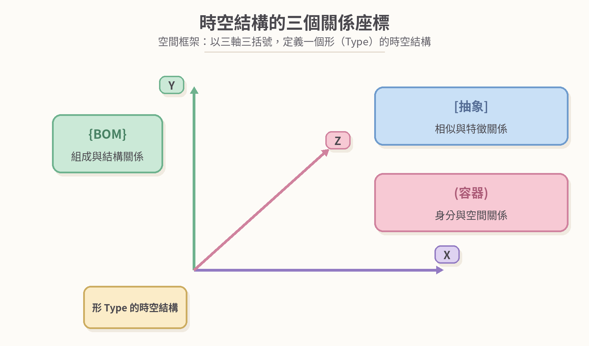

**圖 2-5　時空結構的三個關係座標：空間框架的三軸三括號**

## 2.6　Token 的時空化與權重的兩種樣貌

當每個 Token 都掛上時空結構，Token 之間的權重就換了一種質地：權重不再只回答「它們有多像」，而要回答「它們如何組成、如何歸類、如何依存、如何演化」。壓縮的產物也隨之改變——LLM 的權重是一片分佈式的雲，整體浮現、個案難追；Mind Model 的權重是一張結構化的形網，每一個節點都可以被指認、被命名、被複核。

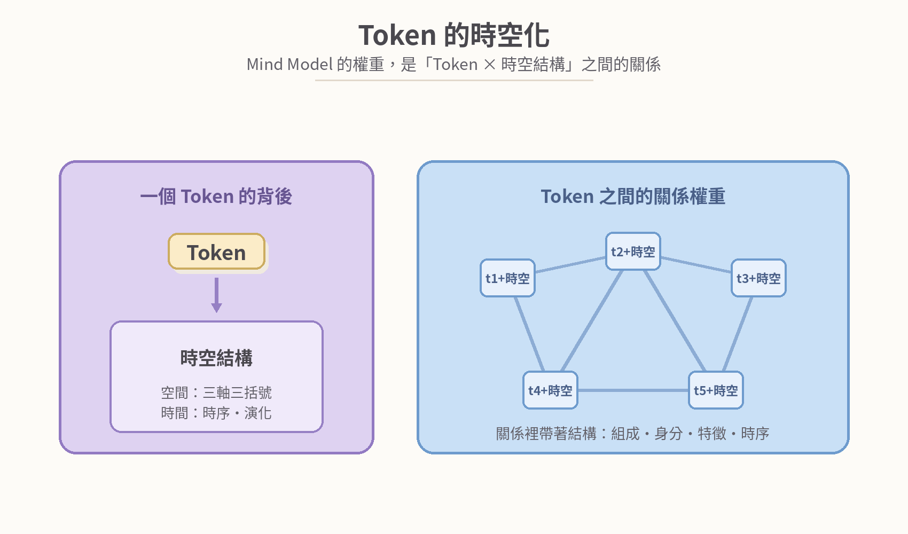

**圖 2-6　Token 的時空化：關係裡帶著結構**

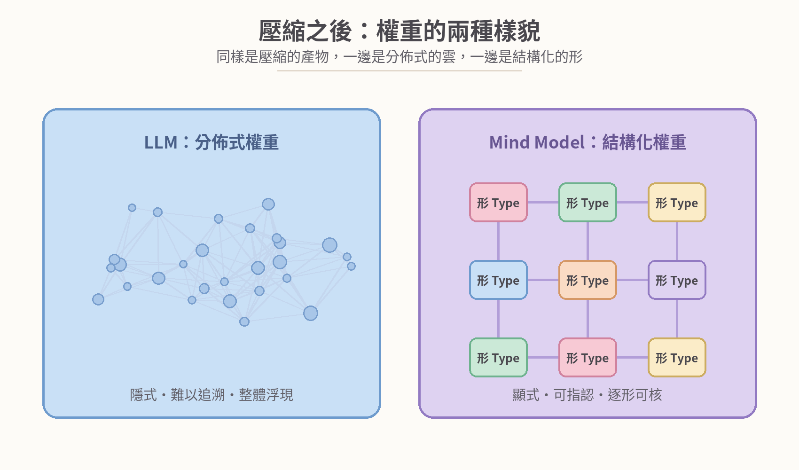

**圖 2-7　壓縮之後：權重的兩種樣貌**

# 第三章　Mind Model 的必要性

## 3.1　LLM 的能力邊界：邊界即定位

LLM 的邊界不是失敗，而是定位。它在語言平面之內近乎完美；但當任務要求「理解」而不只是「表達」時，缺口就出現在時空結構缺席的位置：

- **統計相似 ≠ 結構理解：**知道「像什麼」，不等於知道「是什麼、由什麼組成」。
- **幻覺・依據難追溯：**權重是分佈式的，答案說得出，來源查不到。
- **無持久身分與記憶：**同一個對象在不同對話之間，難以保有恆定的身分。
- **更新代價高：**一項新知識的注入，往往意味著整批的訓練與微調。
- **跨域知識難統一：**語言、數學、物理、工程……各領域的知識，難以在同一表示中互相推演。

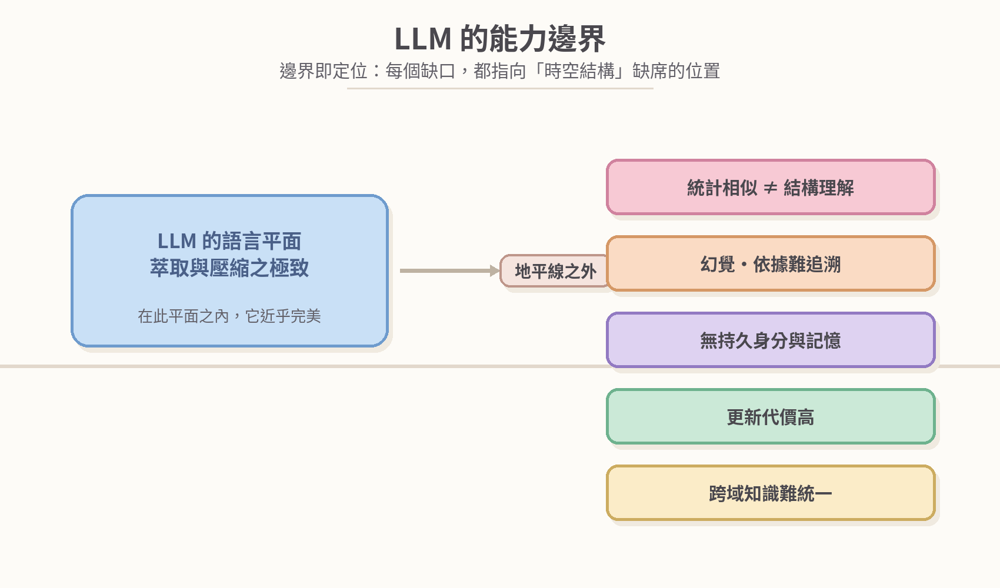

**圖 3-1　LLM 的能力邊界：缺口都在時空結構缺席之處**

## 3.2　五根支柱：從語言能力到智慧能力

要補上這五個缺口，需要的不是更大的參數量，而是一套能把知識立成結構的表示法。Mind Model 以五根支柱，撐起「智慧能力」：

- **知識統一：**單一模型涵蓋跨域知識——語言、數學、物理、工程與日常經驗，共處一套表示。
- **深層推理：**結構判斷與形的運算——不只聯想，而是依組成、身分、特徵推演。
- **時空理解：**狀態・結構・時序齊備——這正是世界模型的入場券。
- **持續演化：**增補・重構・不斷學習——新知識增量進入，不必整批重來。
- **可核可信：**可指認・可命名・可複核——每一個答案都能交回它的形，逐一檢查。

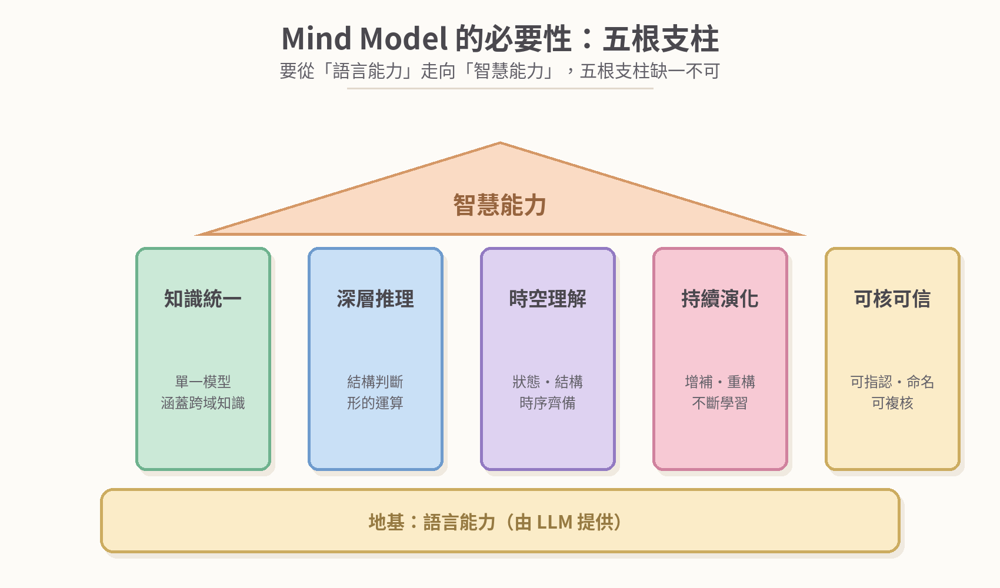

**圖 3-2　Mind Model 的必要性：五根支柱**

## 3.3　互補而非取代

LLM 與 Mind Model 的關係，不是二選一。LLM 負責語言能力——聽、說、讀、寫；Mind Model 負責智慧能力——理解、推理、記憶、學習。前者是人機之間最好的接口，後者是接口背後應該存在的世界。兩者結合，才是完整的智慧系統。

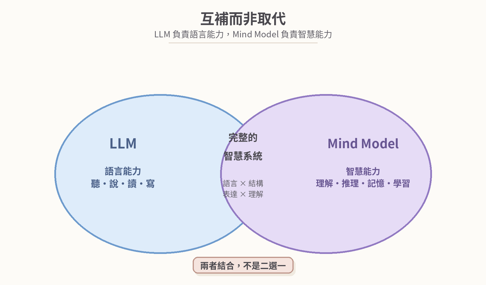

**圖 3-3　互補而非取代：語言能力 × 智慧能力**

# 第四章　世界模型、物理 AI、工業級 AI 的關係

## 4.1　世界模型要什麼

世界模型（World Model），是系統對環境的內部模型。它要回答四個問題：世界此刻是什麼狀態（狀態）？狀態如何變化（轉移）？為什麼這樣變（因果）？接下來會怎樣（預測）？四個問題都是結構問題：狀態需要被表示，轉移需要被寫成可運作的規律，因果需要可追溯的依據，預測需要可推理的底座。純統計的語言權重可以描寫世界「像什麼」；世界模型需要世界「是什麼、會怎麼變」。

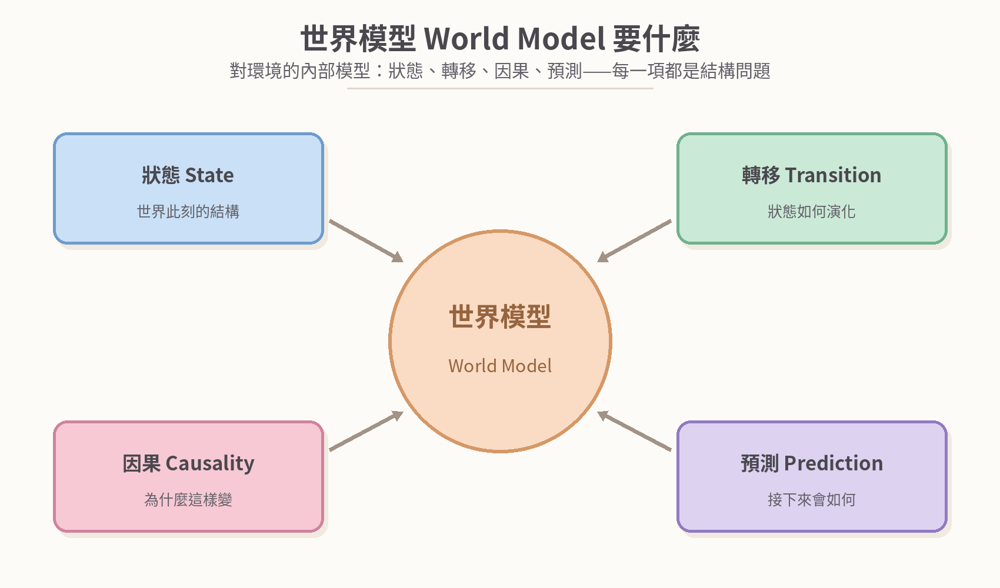

**圖 4-1　世界模型的四個要素：狀態・轉移・因果・預測**

## 4.2　物理 AI 要什麼

物理 AI（Physical AI）把問題拉進真實時空：機器人在真實世界中行動，必須理解具身（自己的身體與行動範圍）、時序控制（動作的先後與節律）、空間定位（位置、姿態、距離）、身分持久（走進廚房，杯子還是那隻杯子）。這些需求有一個共通點：每一項都是「時空結構」的需求——而這正是 Mind Model 的表示法天生要回答的問題。

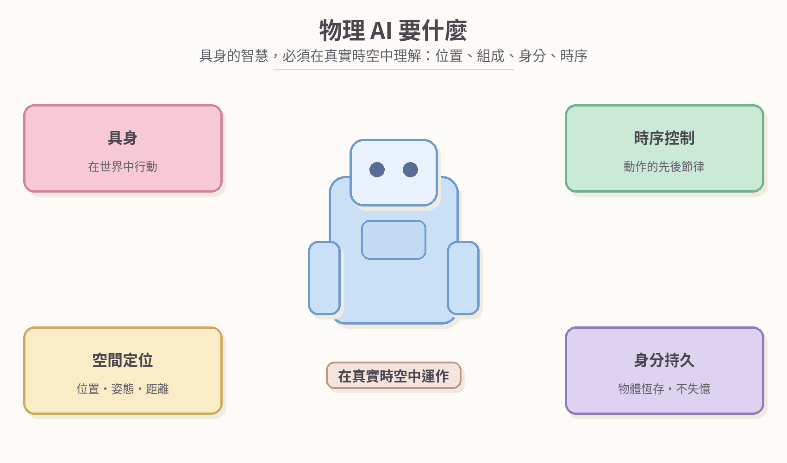

**圖 4-2　物理 AI 的時空需求**

## 4.3　工業級 AI 要什麼

工業級 AI（Industrial AI）把智慧帶進產線與機房：智慧製造、良率優化、預測性維護、數位孿生……產業現場對 AI 的要求，與展示場合截然不同——它要的不是「驚豔」，而是「信賴」。

歸納起來是六件事：穩定可靠（全天候運轉不中斷）、可追溯（每一個決定都有依據）、精確可控（判準明確、閉環控制）、領域知識（工藝、設備、良率的深水區）、持續優化（不停機的增量學習）、安全合規（可審計、可驗收）。六件事有一個共通點：它們都是「結構」的要求，而不是「機率」的要求——這正是 Mind Model 的可核可信、判準明確與增量演化所要回答的問題。

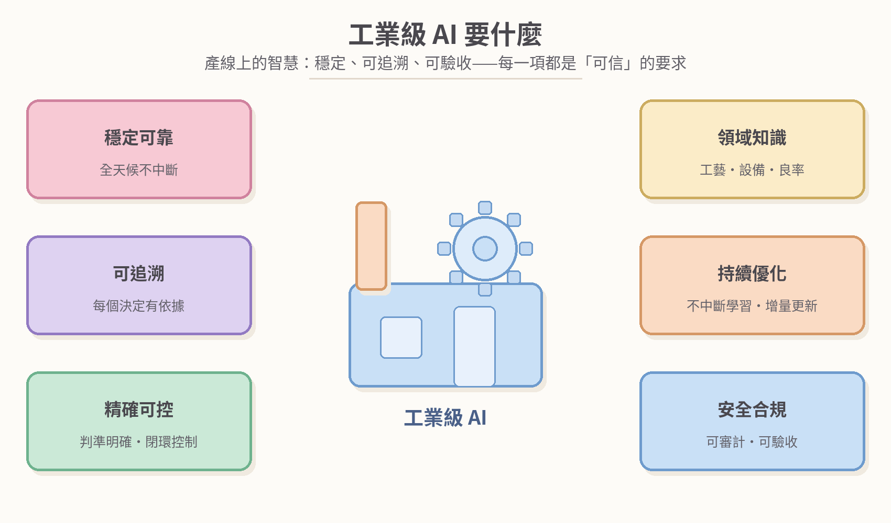

**圖 4-3　工業級 AI 的六項要求**

## 4.4　 Mind AI

LLM 是語言接口——把人的意圖聽進來，把系統的思考說出去；Mind Model 是時空結構的知識骨幹——把世界的狀態與轉移立成可運算的形；Mind AI 是環境與具身——在真實時空中驗證與落地。

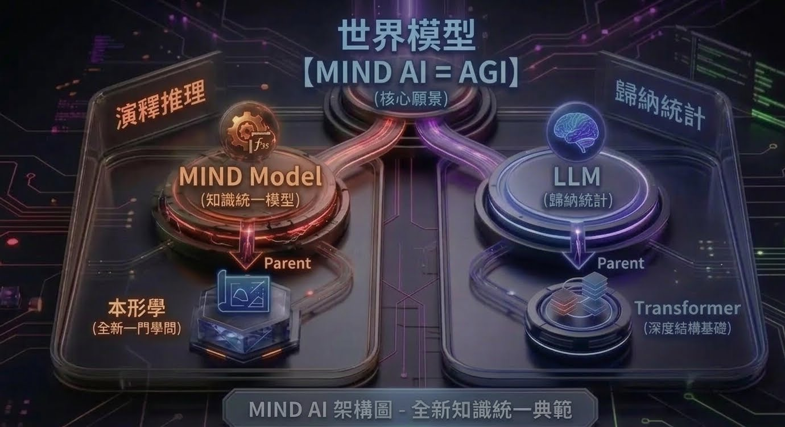

**圖 4-4　Mind AI**

| 世界模型・物理 AI 需要 | Mind Model 的對應表示 |
| --- | --- |
| 狀態 State | 形（Type）在時刻 t 的樣貌（空間結構） |
| 轉移 Transition | 形進形出：輸入一個形，產出一個形（時間結構） |
| 因果 Causality | 結構依存與運算的推導 |
| 預測 Prediction | 由形的運算推演後續的形 |
| 身分持久 | (容器)　身分與空間關係 |
| 組成・部件 | {BOM}　組成與結構關係 |
| 類別・特徵 | [抽象]　相似與特徵關係 |

**表 4-1　對接映射表：世界模型的需求，與時空結構的對應**

# 結語　從關係到結構，從結構到理解

LLM 證明了一件事：把語言壓成關係的權重，機器就能開口說話。Mind Model 要完成下一件事：把語言背後的時空結構壓成關係的權重，機器就能理解世界。

兩條路不是對手，而是接力。語言平面的極致，遇上時空平面的骨幹——世界模型有了可推理的狀態與轉移，物理 AI 有了可依循的身分與時序。從 Token 的關係，到時空的結構，再到可理解的世界：這是萃取與壓縮的下一步，也是 Mind Model 的必要性所在。

**圖 5-1　兩條路的接力：從關係到結構，從結構到理解**

> **LLM 是語言的接口，Mind Model 是時空結構的知識骨幹。**
>
> 壓縮統計，得到語言的極致；壓縮時空結構，得到世界的骨幹。
