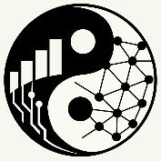
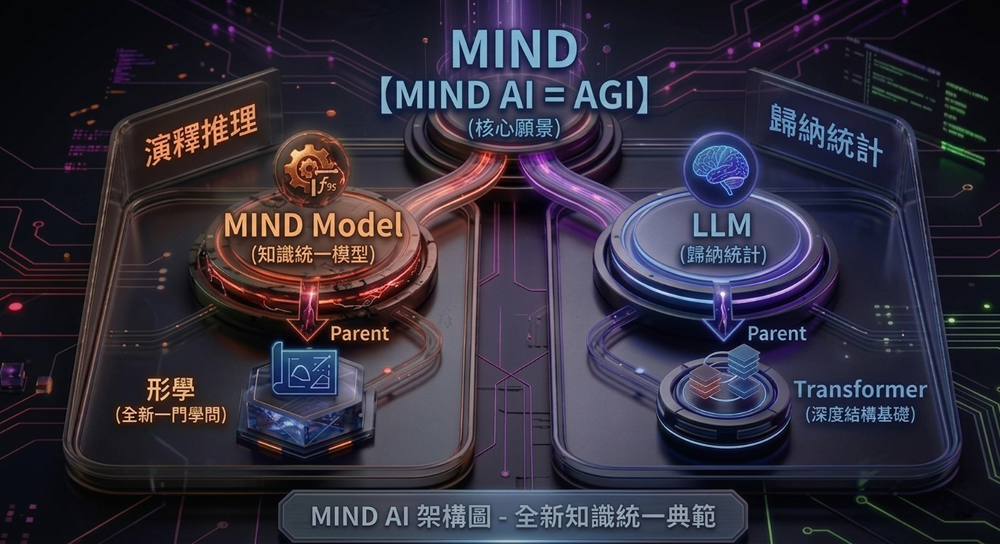

# Mind AI 簡介

Mind AI 是一個專注於 AGI（Artificial General Intelligence，通用人工智慧）研究與實踐的平台。

我們相信，真正的 AGI 並非單純依靠大型語言模型（LLM）參數規模的擴張即可達成，而是需要建立一套能夠統一知識、理解世界、進行推理、持續學習與自主思考的智慧架構。

因此，我們以「本形學（Ontypology）」、「Mind Model（知識統一模型）」與「Mind AI（AGI平台）」三大核心研究方向為基礎，探索並實踐通往 AGI 的永恆之道。

## 一、本形學 Ontypology

### 一門全新的學問

本形學是全新理論體系，研究人類大腦如何透過「形」來認知世界、理解事物、進行推理，以及創造新的知識。

在人類文明的發展歷程中：

- 「數」的研究逐漸發展為數學（Mathematics）
- 「形」的研究則長期散落於各領域之中與被遺漏的，尚未形成完整理論體系的本形學(Ontypology)

我們認為：

人類智慧並非僅由數所構成，而是由「形」與「數」共同構成。

數學描述的是事物的數量、關係與規律；

而本形學描述的是事物的結構、組成、關聯、演化與本質。

因此：

**大腦思考 = 形 + 數**

本形學試圖建立一套能夠跨越語言、數學、科學、哲學、工程與商業領域的統一認知理論，作為未來 AGI 的基礎學科。

### 本形學章節

#### 空間本形 Space Type

1. 簡介 (Space Type)
2. 形与数 (TypeNumber)
3. 單位形與集合邏輯
4. 空间框架 (FrameWork)
5. 數學證明
6. 形集合的運算式
7. 關聯式資料庫與形的關係

#### 時間本形 Time Type

1. 記憶管理 (Memory Management)
2. 注意力 (Attention)
3. 形時間函式搜尋 (Time function search)
4. 設計搜尋與萃取
5. 設計模式 (Design Patterns)
6. 邏輯生成與應用 (Logic generation and application)
7. 持續學習 (Continuous learning)
8. 重構與重組 (Restructuring and Reorganization)
9. 解題 (Problem Analysis)
10. 分析 (Analysis)
11. 設計 (創造與創新)
12. 推理 (因果推理,果因推理,模擬推理,統計推理,逆向推理......)
13. 思考法 (正向思考法,逆向思考法,水準思考法,垂直思考法,第一性原理思考法......)
14. 研發與探索
15. 自我演化 (Self-evolution)

世界萬物皆可由形來表達與理解。

## 二、Mind Model（Unified Knowledge Model）

### 知識統一模型

Mind Model 是本形學理論的實踐架構。

其目標並非建立傳統知識圖譜，而是建立一套能夠模擬人類認知方式的統一知識模型。

#### 為何不是知識圖譜？

傳統知識圖譜雖能描述實體與關係，但仍存在以下限制：

- 關係表達能力有限
- 缺乏深層推理能力
- 難以表示抽象概念
- 缺乏思維結構
- 難以統一跨領域知識
- 難以支持持續演化學習

因此，Mind Model 採用本形學架構，建立更高層次的知識表示方式。

#### 統一知識表示

單一模型可同時容納：

- 語言知識
- 數學知識
- 物理知識
- 化學知識
- 生物知識
- 程式知識
- 哲學知識
- 商業知識
- 工程知識
- 社會知識
- 經驗知識
- 隱性知識

以及未來任何新的知識領域。

#### 統一思維能力

Mind Model 不僅管理知識，更實踐人類核心思維能力：

- 邏輯推理
- 歸納推理
- 演繹推理
- 類比推理
- 因果推理
- 問題分析
- 模式萃取
- 設計模式
- 研發探索
- 創新思考
- 規劃管理
- 決策分析
- 記憶管理
- 持續學習

其核心目標為：

將知識、思維與推理整合於同一套統一架構之中。

## 三、Mind AI

### 通往 AGI 的智慧平台

Mind AI 是本形學與 Mind Model 的實踐平台，也是 AGI 發展的重要基礎設施。

Mind AI 並非單純的大型語言模型系統，而是一套結合：

- 本形學理論
- Mind Model
- 大型語言模型（LLM）
- 推理引擎
- 記憶系統
- 學習系統
- 規劃系統
- 自主決策系統

所形成的完整智慧架構。

#### Mind AI × LLM

大型語言模型擅長：

- 語言理解
- 語言生成
- 知識召回

Mind Model 擅長：

- 知識統一
- 深度推理
- 長期記憶
- 自主學習
- 思維管理

兩者結合後：

LLM 負責語言能力， Mind Model 負責智慧能力。 共同形成完整的 AGI 系統。

#### Mind AI 核心能力

- 理解世界
- 理解知識
- 理解關聯
- 推理與分析
- 持續學習
- 自主規劃
- 自主決策
- 創新與創造
- 跨領域知識整合

最終實現：

從資訊處理走向智慧生成。

### AGI 永恆之道

我們認為 AGI 的發展將經歷三個階段：

**第一階段：知識統一**

建立統一知識表示架構。 解決不同領域知識無法融合的問題。

**第二階段：思維統一**

建立統一推理與思考架構。 讓系統具備真正的理解能力。

**第三階段：智慧統一**

整合知識、思維、記憶、學習與創造能力。 形成完整智慧系統。

最終達成真正的 AGI。

### LonGeat 願景

打造能夠理解世界本質的智慧系統。 從知識統一走向思維統一， 從思維統一走向智慧統一， 從智慧統一走向 AGI。 讓人工智慧不只是工具， 而是真正具備理解、推理、學習與創造能力的智慧生命體系。

**這就是 LonGeat 所追求的：AGI 永恆之道。**
